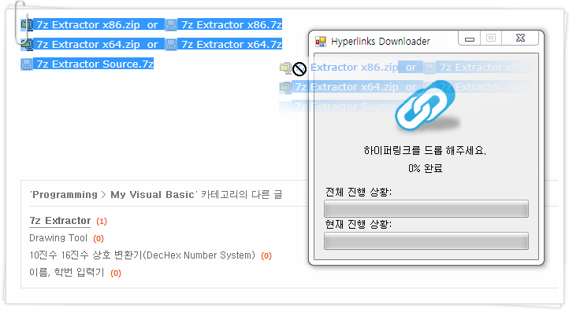

# Hyperlinks Downloader

[English](README.md)

웹 페이지에서 링크 여러 개를 골라 창에 끌어다 놓으면 링크가 가리키는 파일을 차례로 내려받는 프로그램이다. 저장할 폴더를 고르면 링크 글자를 파일 이름으로 삼아 하나씩 받고 전체 진행 상황과 지금 받는 파일의 진행 상황을 막대 두 개로 보여 준다. 블로그 첨부 파일처럼 링크 글자가 곧 파일 이름인 목록을 한꺼번에 받는 데 맞춰져 있다.

<p>
  
</p>


## 사용 방법

Releases에서 받아 실행하면 된다. x86 판과 x64 판이 있으니 Windows 에 맞는 것을 쓰고, .NET Framework 4.5 가 있어야 한다.

브라우저에서 파일 링크가 들어 있는 부분을 드래그로 선택해 창에 끌어다 놓는다. 저장할 폴더를 묻는 창이 뜨고 폴더를 고르면 선택 영역 안의 링크를 순서대로 하나씩 내려받는다. 파일 이름은 링크 글자에서 앞뒤 공백을 뺀 것이다. 창은 항상 위에 떠 있어서 브라우저 위에 겹쳐 둔 채로 쓸 수 있다.

위 막대는 전체 링크 중 받은 파일 수, 아래 막대는 지금 받는 파일의 진행률이다. 다 받으면 "다운로드가 완료되었습니다." 가 뜬다. 받다가 오류가 나면 그 파일을 지우고 파일 이름과 함께 오류를 알린 뒤 멈춘다.


## 구현 원리

**드롭된 HTML 조각에서 링크를 뽑는다.** 브라우저에서 끌어 온 데이터를 `DataFormats.Html` 형식으로 꺼내 화면에 띄우지 않은 `WebBrowser` 의 빈 문서에 써 넣는다. 그러면 브라우저 엔진이 HTML 을 해석해 `HtmlDocument.Links` 에 링크 목록을 만들어 주므로, 각 링크의 `href` 를 주소로, `OuterText` 를 파일 이름으로 쓴다.

```vb
Public Function GetHtmlDocument(ByRef strhtml As String) As HtmlDocument
    Dim browser As New WebBrowser
    Dim result As HtmlDocument
    browser.DocumentText = ""
    browser.ScriptErrorsSuppressed = True
    result = browser.Document.OpenNew(True)
    result.Write(strhtml)
    Return result
End Function
```

**다운로드는 완료 이벤트로 이어 붙인다.** `WebClient.DownloadFileAsync` 로 첫 링크를 받기 시작하고, `DownloadFileCompleted` 에서 받은 개수를 하나 올린 뒤 남은 링크가 있으면 새 `WebClient` 로 다음 링크를 받는다. 한 번에 한 파일씩 받으므로 순서가 지켜지고 비동기라서 받는 동안에도 창이 멈추지 않는다. 아래 막대에는 `DownloadProgressChanged` 가 넘기는 받은 바이트와 전체 바이트를 그대로 넣는다.


## 파일

| 경로 | 내용 |
|---|---|
| `source/Hyperlinks Downloader.sln` | Visual Studio 2013 솔루션 |
| `source/Hyperlinks Downloader/Form1.vb` | 드롭 처리, 링크 추출, 다운로드 |
| `source/Hyperlinks Downloader/Form1.Designer.vb` | 폼 디자인 |
| `source/Hyperlinks Downloader/Resources/link.png` | 창에 표시하는 그림 |
| `docs/screenshots/` | 스크린샷 |
| Releases | x86, x64 실행 파일 |


## 라이선스

zlib 라이선스다. 자세한 내용은 [LICENSE](LICENSE) 에 있다.
